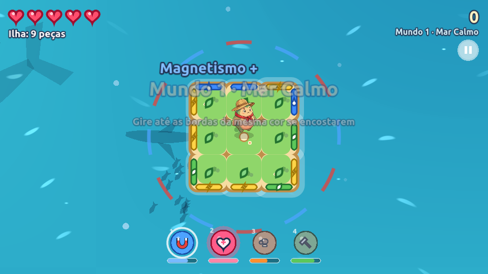
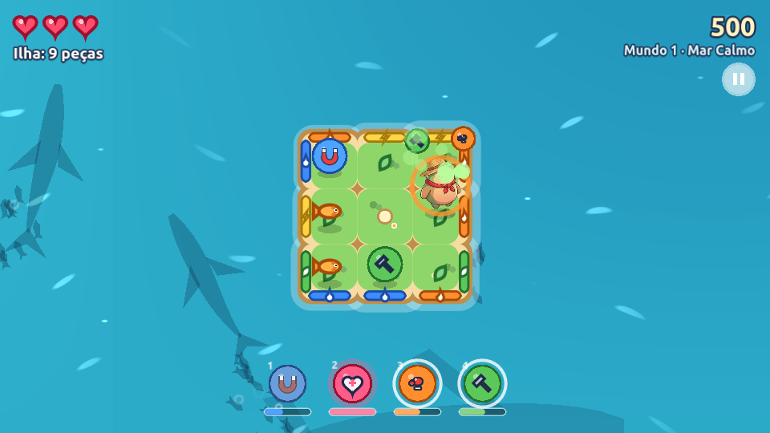

# Ilha Flutuante

Jogo de ação e quebra-cabeça para celular (paisagem), feito na **Godot 4.3**.
Você controla uma ilha flutuante: gire e mova a ilha para que as bordas da mesma cor se encostem nas ilhas que chegam. Assim ela cresce e protege o **Tobé** dos monstros e do mar.

Feito a partir do GDD "GDD — Ilha Flutuante".



---

## Sumário

- [Como rodar](#como-rodar)
- [Controles](#controles)
- [Como se joga](#como-se-joga)
- [Poderes do Tobé](#poderes-do-tobé)
- [Itens](#itens)
- [Monstros](#monstros)
- [Vida no mar](#vida-no-mar)
- [Mundos](#mundos)
- [Pontuação](#pontuação)
- [Estrutura do projeto](#estrutura-do-projeto)
- [Ajustar o equilíbrio](#ajustar-o-equilíbrio)
- [Arte e som](#arte-e-som)
- [Testes](#testes)
- [Exportar para celular](#exportar-para-celular)
- [O que ainda falta](#o-que-ainda-falta)

---

## Como rodar

1. Abra a Godot 4.3 (`~/Documentos/games/Godot_v4.3-stable_linux.x86_64`).
2. Importe esta pasta (`project.godot`) e aperte **F5**.

Ou direto pelo terminal, de dentro desta pasta:

```bash
~/Documentos/games/Godot_v4.3-stable_linux.x86_64 --path .
```

A tela é **1280×720 em paisagem**. No computador a janela abre em 960×540 e pode ser redimensionada.

## Controles

| Ação | Teclado | Celular / mouse |
| --- | --- | --- |
| Girar ↺ e andar para a esquerda | ← (ou A, Q) | Tocar na metade esquerda da tela |
| Girar ↻ e andar para a direita | → (ou D, E) | Tocar na metade direita da tela |
| Guiar o Tobé | Clicar numa peça da ilha | Tocar numa peça da ilha |
| Usar um poder (barra cheia) | 1 / 2 / 3 / 4 | Tocar no ícone do poder (embaixo) |
| Pausar | Esc / P | Botão de pausa (canto de cima) |
| Começar / jogar de novo | Espaço / Enter | Tocar na tela |

**Toque curto x toque longo**

- **Toque curto:** a ilha gira 90° de forma suave e anda um pouco para aquele lado.
- **Segurar:** o giro e o movimento aceleram aos poucos até um limite. A ilha nunca gira como um pião.
- **Ao soltar:** o giro termina devagar no próximo encaixe de 90°, e a ilha ainda desliza um pouco antes de parar.

## Como se joga

**Encaixe por cor**

- Existem 4 elementos: **Folha** (verde), **Brasa** (laranja), **Gota** (azul) e **Raio** (amarelo).
- Toda peça tem as 4 cores, uma em cada lado, em ordem sorteada.
- Uma ilha que chega só gruda se o lado dela que encosta tiver **a mesma cor** da borda da sua ilha naquele ponto. Gire a sua ilha para acertar.
- A vaga onde a ilha vai encostar acende em **verde** (vai grudar) ou **vermelho** (vai bater).
- O aviso na beira da tela mostra a cor do lado que vai encostar, para você se preparar antes.
- **Cor errada:** a ilha quica, o combo zera e o Tobé fica tonto por um instante.

**Peças afundam**

- Cada peça afunda **60 segundos** depois de grudar. Aos 45 s aparecem rachaduras, e nos últimos 10 s a água sobe.
- O Tobé **não pisa em peça rachada**: ele dá a volta, e tocar numa peça rachada não manda ele para lá.
- Se a peça do Tobé afundar mesmo assim, ele **pula para a peça mais perto**.
- Pedaços que ficam separados do Tobé se soltam e vão à deriva.
- **Fim de jogo:** quando **todas as peças afundarem** ou quando o Tobé perder todos os corações.

**O Tobé**

- Anda sozinho: foge de monstros, sai de peças rachadas e busca itens.
- Se você tocar numa peça, ele vai até lá, espera 2,5 s e volta a andar sozinho. Um anel branco marca o destino.
- Tem até **5 corações**.

## Poderes do Tobé

Os poderes ficam numa fileira embaixo da tela, cada um com sua **barrinha**.

- **Como encher:** cada **orbe de poder** que chega numa ilha enche **meia barra**, e cada encaixe certo enche **um pouquinho de todas**.
- **Barra cheia:** o ícone brilha. Toque nele (ou aperte 1–4) para usar.
- **Enquanto o poder está ligado:** a barrinha vai esvaziando.

| # | Poder | Duração | O que faz |
| --- | --- | --- | --- |
| 1 | **Magnetismo** | 10 s | Puxa para a sua ilha as ilhas que passam perto. Anéis vermelhos e azuis giram em volta da ilha. |
| 2 | **Vida** | na hora | +2 corações (máximo 5) e 2 s sem levar dano. |
| 3 | **Super soco** | 8 s | O Tobé corre atrás dos monstros e joga cada um ao mar com um soco (pontos em dobro). Não leva dano enquanto dura. |
| 4 | **Conserto** | 8 s | O Tobé vai até a peça mais perto de afundar e a conserta: a peça recupera vida rápido. |



## Itens

Chegam em cima das ilhas. O Tobé pega quando passa por eles.

| Item | Efeito |
| --- | --- |
| Tesouro | +300 pontos |
| Comida | Tobé 50% mais rápido por 10 s |
| Vida | +1 coração |
| Âncora | Nenhuma peça envelhece por 10 s |
| Escudo | Bloqueia o próximo golpe de monstro |
| Peixe | +1 coração (ou +150 pontos com a vida cheia) — veja [Vida no mar](#vida-no-mar) |
| Orbe de poder | Enche meia barra do poder |
| **Ilha dourada** | Gruda em qualquer cor e traz tesouro (+300) |

## Monstros

Alguns chegam em cima das ilhas e, ao grudar, perseguem o Tobé. Cada um tem um **ponto fraco** (uma cor).
Quando um encaixe acontece na cor do ponto fraco, sai uma **onda elemental** que joga ao mar todos os monstros com aquele ponto fraco.

| Monstro | Aparece a partir de | Jeito | Pontos |
| --- | --- | --- | --- |
| Gorila | Mundo 1 | Dá investidas a cada 5 s | 250 |
| Hiena gigante | Mundo 2 | Rápida, mas para de tempos em tempos | 300 |
| Mapinguari | Mundo 3 | Lento e grande | 350 |
| Boitatá | Mundo 4 | Rápido | 400 |

## Vida no mar

Embaixo d'água passam **sombras de tubarões, baleias e cardumes**. Elas mexem a cauda e escurecem à noite.

- Cardumes com **bolhinhas** estão prontos para soltar um peixe.
- Leve a ilha por cima de um cardume: **um peixe pula** numa peça livre, e o Tobé come.
- Cada cardume solta um peixe a cada 12 s.

## Mundos

O modo atual é **arcade contínuo**: os mundos mudam a cada 80 s, e o último dura até o fim.

| Mundo | Novidade |
| --- | --- |
| 1 · Mar Calmo | Aprendizado: poucas ilhas, só gorilas |
| 2 · Correntes | Correntes empurram as ilhas que chegam; **ondas de ilhas** (3 de uma vez) |
| 3 · Mar Noturno | Escuro, monstros mais fortes |
| 4 · Tempestade | Chuva, relâmpagos e ondas de 4 a 5 ilhas |

## Pontuação

- **Encaixe:** 100 × combo.
- **Combo:** sobe a cada encaixe certo seguido e zera na batida. O multiplicador fica em ×2 a partir de 3, ×3 a partir de 6, ×4 a partir de 10 e ×5 a partir de 15.
- **Monstro ao mar:** pontos do monstro × combo (× 2 com o super soco).
- **Recorde:** o melhor placar e o maior tamanho de ilha ficam salvos em `user://save.cfg`.

## Estrutura do projeto

```
godot/
├── project.godot          configuração (paisagem 1280×720, renderizador Mobile)
├── scenes/main.tscn       cena única; tudo é montado por código
├── scripts/
│   ├── g.gd               autoload "G": constantes, balanceamento, teclas e desenhos
│   ├── main.gd            regras: estados, ilhas chegando, encaixe, Tobé, monstros, poderes, peixes
│   ├── island.gd          a ilha do jogador: grade, giro/movimento, cores, caminhos e desenho
│   ├── incoming.gd        ilha que chega flutuando (4 cores, item ou monstro)
│   ├── actor.gd           Tobé e monstros andando pela grade
│   ├── hud.gd             interface: corações, pontos, poderes, avisos, menu, fim, toques
│   ├── sealife.gd         sombras dos animais marinhos e cardumes
│   ├── fishjump.gd        animação do peixe pulando na ilha
│   └── sfx.gd             efeitos sonoros sintetizados
├── shaders/               mar (sea) e efeitos de tela: noite, chuva, relâmpago, dano (overlay)
├── assets/
│   ├── sprites/           PNGs usados no jogo (substituem os desenhos em código)
│   ├── raw/               imagens originais (ignoradas pela Godot)
│   └── music/tema.mp3     música
├── tools/gerar_sombras.py gera as sombras dos animais no Gemini
└── docs/                  imagens deste README
```

## Ajustar o equilíbrio

Quase todos os números ficam em `scripts/g.gd`:

| Constante | Para que serve |
| --- | --- |
| `PIECE_LIFE`, `CRACK_AT` | Quando a peça afunda (60 s) e quando racha (45 s) |
| `SPIN_MIN`, `SPIN_MAX`, `SPIN_ACCEL`, `HOLD_RAMP` | Velocidade e suavidade do giro |
| `MOVE_MIN`, `MOVE_MAX`, `MOVE_ACCEL`, `MOVE_FRICTION` | Velocidade do movimento e o quanto a ilha desliza depois de soltar |
| `POWER_INFO`, `POWER_PICKUP`, `POWER_PER_ATTACH` | Duração dos poderes e quanto cada orbe/encaixe enche a barra |
| `WORLDS` | Por mundo: ilhas por minuto (`ipm`), velocidade, chance de monstro e item, clima |
| `MONSTERS` | Velocidade e pontos de cada monstro |
| `ITEMS`, `ITEM_WEIGHTS` | Itens e a chance de cada um |
| `WORLD_TIME` | Duração de cada mundo (80 s) |

## Arte e som

**Personagens:** o Tobé, o gorila, a hiena, o Mapinguari e o Boitatá foram gerados no Gemini. Os originais estão em `assets/raw` e os recortes em `assets/sprites`.

**Desenhos em código:** peças, itens, poderes, peixe, sombras dos animais e interface, no mesmo estilo cartunesco.

**Trocar um desenho por imagem:** coloque um PNG com fundo transparente em `assets/sprites/` com um destes nomes. Ele substitui o desenho na hora (abra o projeto na Godot uma vez para importar):

`tobe`, `gorila`, `hiena`, `mapinguari`, `boitata`, `tesouro`, `comida`, `vida`, `ancora`, `escudo`, `peixe`,
`poder_ima`, `poder_coracao`, `poder_soco`, `poder_conserto`, `sombra_tubarao`, `sombra_baleia`, `sombra_peixe`.

Os poderes aparecem dentro de uma medalha colorida, então o PNG deve ter só o objeto.

**Sugestões de pedido para o Gemini** (no estilo do Tobé):

- `poder_ima`: "ícone de jogo cartunesco, ímã de ferradura vermelho com pontas prateadas e faíscas azuis, contorno escuro grosso, fundo transparente, sem texto"
- `poder_coracao`: "ícone de jogo cartunesco, coração rosa brilhante com sinal de mais branco, contorno escuro grosso, fundo transparente, sem texto"
- `poder_soco`: "ícone de jogo cartunesco, luva de boxe vermelha dando um soco com linhas de velocidade, contorno escuro grosso, fundo transparente, sem texto"
- `poder_conserto`: "ícone de jogo cartunesco, martelo de madeira com cabeça de metal e estrelinhas de brilho, contorno escuro grosso, fundo transparente, sem texto"
- `peixe`: "peixinho laranja cartunesco visto de lado, contorno escuro grosso, fundo transparente"

### Sombras dos animais marinhos (Gemini)

O script `tools/gerar_sombras.py` faz tudo sozinho:

1. Pede ao Gemini as silhuetas vistas de cima (tubarão, baleia e o peixe usado nos cardumes).
2. Transforma cada uma em sombra transparente, com a cabeça para a direita.
3. Salva em `assets/sprites/sombra_*.png` (os originais vão para `assets/raw`) e importa na Godot.

O jogo pinta as sombras com a cor do fundo do mar.

```bash
GEMINI_API_KEY=sua_chave python3 tools/gerar_sombras.py            # todas
GEMINI_API_KEY=sua_chave python3 tools/gerar_sombras.py baleia     # refazer só uma
python3 tools/gerar_sombras.py --virar tubarao                     # se a cabeça ficou para a esquerda
```

Precisa do Python com `google-genai` e `Pillow`.

**Som:** a música é do Suno (`assets/music/tema.mp3`). Os efeitos são sintetizados no código: cada elemento toca uma nota do mesmo acorde, e a nota sobe com o combo.

## Testes

```bash
# robô que joga sozinho (sem janela) e imprime o resultado de cada partida
~/Documentos/games/Godot_v4.3-stable_linux.x86_64 --headless --path . --fixed-fps 20 --quit-after 6000 -- autoplay

# cenas de demonstração (com janela)
~/Documentos/games/Godot_v4.3-stable_linux.x86_64 --path . -- demo_powers        # magnetismo ligado
~/Documentos/games/Godot_v4.3-stable_linux.x86_64 --path . -- demo_powers soco   # super soco + conserto
~/Documentos/games/Godot_v4.3-stable_linux.x86_64 --path . -- demo_monsters      # todos os monstros
~/Documentos/games/Godot_v4.3-stable_linux.x86_64 --path . -- demo_over          # tela de fim

# teste: a peça do Tobé afunda e ele deve pular para outra (imprime o resultado)
~/Documentos/games/Godot_v4.3-stable_linux.x86_64 --headless --path . -- test_sink
```

Os modos de teste não gravam recorde.

## Exportar para celular

Em **Projeto → Exportar**, adicione o modelo **Android**. Isso precisa do SDK Android e dos modelos de exportação da Godot 4.3.
O projeto já está em paisagem (gira com o sensor), usa o renderizador Mobile e aceita toque.

## O que ainda falta

Em relação ao GDD:

- **Campanha com fases e chefes:** hoje é só o modo arcade. As 20 fases em JSON e os chefes (Gorila Rei etc.) ainda não foram feitos.
- **Arte em imagem** dos itens, poderes e sombras: hoje são desenhados em código, mas dá para trocar (veja [Arte e som](#arte-e-som)).
- **Música:** só um tema do Suno; o GDD prevê um por mundo.
- **Elementos do GDD que faltam:** redemoinhos, ilha dupla, ilha grande e ilha camaleão.
- **Ilhas hexagonais** (6 lados): proposta em análise.
- **Exportação para Android:** ainda não configurada.
