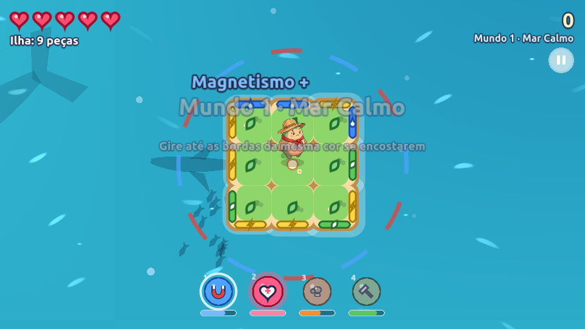
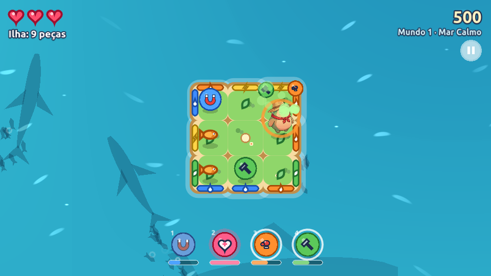

# Ilha Flutuante

Jogo de ação e quebra-cabeça para celular (paisagem), feito na **Godot 4.3**.
Você controla uma ilha flutuante: gire e mova a ilha para que as bordas da mesma cor se encostem nas ilhas que chegam. Assim ela cresce e protege o **Tobé** dos monstros e do mar.

Feito a partir do GDD "GDD — Ilha Flutuante".



---

## Sumário

- [Como rodar](#como-rodar)
- [Controles](#controles)
- [Como se joga](#como-se-joga)
- [Poderes do Tobé](#poderes-do-tobé)
- [Itens](#itens)
- [Monstros](#monstros)
- [Caranguejos e siri](#caranguejos-e-siri)
- [Missões](#missões)
- [Coqueiro e tubarões](#coqueiro-e-tubarões)
- [Álbum](#álbum)
- [Vida no mar](#vida-no-mar)
- [Mundos](#mundos)
- [Pontuação](#pontuação)
- [Estrutura do projeto](#estrutura-do-projeto)
- [Ajustar o equilíbrio](#ajustar-o-equilíbrio)
- [Arte e som](#arte-e-som)
- [Testes](#testes)
- [Exportar para celular](#exportar-para-celular)
- [O que ainda falta](#o-que-ainda-falta)

---

## Como rodar

1. Abra a Godot 4.3 (`~/Documentos/games/Godot_v4.3-stable_linux.x86_64`).
2. Importe esta pasta (`project.godot`) e aperte **F5**.

Ou direto pelo terminal, de dentro desta pasta:

```bash
~/Documentos/games/Godot_v4.3-stable_linux.x86_64 --path .
```

A tela é **1280×720 em paisagem**. No computador a janela abre em 960×540 e pode ser redimensionada.

## Controles

| Ação | Teclado | Celular / mouse |
| --- | --- | --- |
| Girar ↺ e andar para a esquerda | ← (ou A, Q) | Tocar na metade esquerda da tela |
| Girar ↻ e andar para a direita | → (ou D, E) | Tocar na metade direita da tela |
| Guiar o Tobé | Clicar numa peça da ilha | Tocar numa peça da ilha |
| Usar um poder (barra cheia) | 1 / 2 / 3 / 4 | Tocar no ícone do poder (embaixo) |
| Usar o poder especial | 5 | Tocar no 5º ícone (roxo) |
| Girar uma ilha que chega (com o Redemoinho ligado) | — | Tocar na ilha |
| Pausar | Esc / P | Botão de pausa (canto de cima) |
| Opções (volume, menu, sair) | — | Botão de engrenagem (canto de cima) |
| Começar / jogar de novo | Espaço / Enter | Tocar na tela |
| Álbum (coleção) | — | Botão "Álbum" no canto de baixo da tela inicial (Esc fecha) |

**Opções**

- A engrenagem fica ao lado do pause durante o jogo e no canto de cima na tela inicial.
- **Música** e **Efeitos** têm volume separado (arraste a barra; o alto-falante liga e desliga o som). O volume fica salvo em `user://opcoes.cfg`.
- **Continuar** volta ao jogo. **Menu inicial** abandona a partida. **Sair do jogo** fecha o app (não aparece na versão Web).
- Esc fecha o painel.

**Toque curto x toque longo**

- **Toque curto:** a ilha gira 90° de forma suave e anda um pouco para aquele lado.
- **Segurar:** o giro e o movimento aceleram aos poucos até um limite. A ilha nunca gira como um pião.
- **Ao soltar:** o giro termina devagar no próximo encaixe de 90°, e a ilha ainda desliza um pouco antes de parar.

## Como se joga

**Encaixe por cor**

- Existem 4 elementos: **Folha** (verde), **Brasa** (laranja), **Gota** (azul) e **Raio** (amarelo).
- Toda peça tem as 4 cores, uma em cada lado, em ordem sorteada.
- Uma ilha que chega só gruda se o lado dela que encosta tiver **a mesma cor** da borda da sua ilha naquele ponto. Gire a sua ilha para acertar.
- A vaga onde a ilha vai encostar acende em **verde** (vai grudar) ou **vermelho** (vai bater).
- O aviso na beira da tela mostra a cor do lado que vai encostar, para você se preparar antes.
- **Cor errada:** a ilha quica, o combo zera e o Tobé fica tonto por um instante.

**Peças afundam**

- Cada peça afunda **60 segundos** depois de grudar. Aos 45 s aparecem rachaduras, e nos últimos 10 s a água sobe.
- O Tobé **não pisa em peça rachada**: ele dá a volta, e tocar numa peça rachada não manda ele para lá.
- Se a peça do Tobé afundar mesmo assim, ele **pula para a peça mais perto**.
- Pedaços que ficam separados do Tobé se soltam e vão à deriva.
- **Fim de jogo:** quando **todas as peças afundarem** ou quando o Tobé perder todos os corações.

**O Tobé**

- Anda sozinho: foge de monstros, sai de peças rachadas e busca itens.
- Se você tocar numa peça, ele vai até lá, espera 2,5 s e volta a andar sozinho. Um anel branco marca o destino.
- Tem até **5 corações**.

## Poderes do Tobé

Os poderes ficam numa fileira embaixo da tela, cada um com sua **barrinha**.

- **Cada cor enche um poder:** encaixar uma ilha enche a barra do poder daquela cor (12% por encaixe). O símbolo da cor aparece no canto de cada ícone.

| Cor | Poder |
| --- | --- |
| Folha (verde) | Conserto |
| Brasa (laranja) | Super soco |
| Gota (azul) | Vida |
| Raio (amarelo) | Magnetismo |

- **Orbe de poder:** chega numa ilha e enche **meia barra** daquele poder. Agora aparece cerca de 2 vezes mais.
- **Ilha dourada:** enche um pouquinho de todas.
- **Barra cheia:** o ícone brilha. Toque nele (ou aperte 1–4) para usar.
- **Enquanto o poder está ligado:** a barrinha vai esvaziando.

| # | Poder | Duração | O que faz |
| --- | --- | --- | --- |
| 1 | **Magnetismo** | 10 s | Puxa para a sua ilha as ilhas que passam perto. Anéis vermelhos e azuis giram em volta da ilha. |
| 2 | **Vida** | na hora | +2 corações (máximo 5) e 2 s sem levar dano. |
| 3 | **Super soco** | 8 s | O Tobé corre atrás dos monstros e joga cada um ao mar com um soco (pontos em dobro). Não leva dano enquanto dura. |
| 4 | **Conserto** | 8 s | O Tobé vai até a peça mais perto de afundar e a conserta: a peça recupera vida rápido. |

**Poder especial (5º espaço, roxo)**

Guarda um poder por vez; pegar outro troca o que estava lá (menos enquanto um especial está ligado). Hoje existem quatro:

| Poder | Duração | Como ganhar | O que faz |
| --- | --- | --- | --- |
| **Redemoinho** | 8 s | Fazer combo de 8, ou pegar o orbe roxo numa ilha | Tocar numa ilha que está chegando gira as cores dela 90° no sentido horário. Não vale para a ilha dourada nem para a ilha de uma cor só. |
| **Estrela-do-mar** | 15 s | Chega numa ilha a cada ~3 min, prêmio da baleia ou do desafio "Chegue a 12 peças" | Tobé invencível (monstro que encosta voa para o mar, caranguejo é jogado longe), as peças atuais ganham o dobro do tempo que ainda tinham e todas as barras ganham +1/4. |
| **Chuva de cocos** | 6 s | Encaixar o coqueiro atirador na cor certa | O Tobé atira um coco a cada 0,45 s no inimigo mais perto: monstro, caranguejo ou tubarão. 1 coco derruba 1 inimigo. |
| **Bolha do siri** | 15 s ou 1 batida | Encostar no siri a borda da cor da plaquinha dele | Uma bolha cobre a ilha toda e segura 1 caranguejo de cor errada, 1 tubarão ou 1 coco. Depois estoura. |



## Itens

Chegam em cima das ilhas. O Tobé pega quando passa por eles.

| Item | Efeito |
| --- | --- |
| Tesouro | +300 pontos |
| Comida | Tobé 50% mais rápido por 10 s |
| Vida | +1 coração |
| Âncora | Nenhuma peça envelhece por 10 s |
| Escudo | Bloqueia o próximo golpe de monstro |
| Peixe | +1 coração (ou +150 pontos com a vida cheia) — veja [Vida no mar](#vida-no-mar) |
| Orbe de poder | Enche meia barra do poder |
| **Ilha dourada** | Gruda em qualquer cor e traz tesouro (+300) |
| **Ilha de uma cor só** (rara, 1 em 30) | Os 4 lados da mesma cor e brilho em volta. Precisa da cor certa, mas dura **3 minutos** e enche o dobro da barra |
| **Peixe arco-íris** (raro, 1 em 8 peixes) | Enche por completo um poder sorteado e dá +200 pontos. Vai para o álbum |
| **Cavalo-marinho** (raro, 1 em 15 peixes) | Igual ao peixe arco-íris e vai para o álbum |
| **Conchas** (5 tipos, 1 em 20 ilhas) | +50 pontos e vão para o álbum. Conchas que faltam no álbum aparecem mais |

## Monstros

Alguns chegam em cima das ilhas e, ao grudar, perseguem o Tobé. Cada um tem um **ponto fraco** (uma cor).
Quando um encaixe acontece na cor do ponto fraco, sai uma **onda elemental** que joga ao mar todos os monstros com aquele ponto fraco.

| Monstro | Aparece a partir de | Jeito | Pontos |
| --- | --- | --- | --- |
| Gorila | Mundo 1 | Dá investidas a cada 5 s | 250 |
| Hiena gigante | Mundo 2 | Rápida, mas para de tempos em tempos | 300 |
| Mapinguari | Mundo 3 | Lento e grande | 350 |
| Boitatá | Mundo 4 | Rápido | 400 |

## Caranguejos e siri

Bichos que vêm de fora e usam a regra da cor ao contrário: aqui a **cor certa defende**.

**Onda de caranguejos** (a partir do Mundo 2)

- **Aviso:** 2 s antes, aparecem bolhinhas na borda da tela de onde eles vêm, e o letreiro "Caranguejos!".
- **Onda:** 4 caranguejos no Mundo 2, 5 no 3 e 6 no 4. Vêm em fila do mesmo lado, nadando até a ilha.
- **Cores:** cada onda tem 1 cor no Mundo 2 e até 2 cores depois. As cores são sempre de bordas que a ilha tem.
- **Borda da cor dele:** o caranguejo é jogado longe e dá 50 × combo pontos.
- **Borda de outra cor:** ele gruda e a peça perde 15 s de vida. Depois de 5 s ele cai no mar.
- **Defesas:** a Bolha do siri segura 1 caranguejo, e o Super soco ligado joga todos longe.
- **Intervalo:** uma onda a cada 22 a 32 s no Mundo 2, um pouco menos nos seguintes; só começa outra depois que a anterior acaba.

**Siri presenteador** (a partir dos 35 s, no Mundo 1)

- Passa devagar numa ilhota, segurando uma plaquinha com uma cor que a ilha tem na borda.
- **Borda da cor da plaquinha:** ele dá a **Bolha do siri** (5º espaço) e vai embora acenando. Se um especial estiver ligado, dá +300 pontos.
- **Outra cor:** ele se assusta e mergulha, sem castigo.
- Aparece de novo a cada 40 a 55 s.

## Missões

**Desafios do Tobé**

Um desafio por vez aparece num cartão embaixo do tamanho da ilha, com o prêmio, o texto e uma barrinha de progresso.
O primeiro vem aos 10 s; depois de cumprir um, o próximo vem 8 s depois. Um desafio não cumprido em 75 s é trocado.

| Desafio | A partir do | Prêmio |
| --- | --- | --- |
| Coma 5 peixes | Mundo 1 | Vida cheia |
| Faça combo de 6 | Mundo 1 | Redemoinho |
| Encaixe 5 peças de uma cor (sorteada) | Mundo 1 | Barra do poder daquela cor cheia |
| Jogue 3 monstros ao mar | Mundo 2 | Chuva de cocos |
| Defenda 5 caranguejos | Mundo 2 | Bolha do siri |
| Desvie de 1 onda de tubarões | Mundo 4 | Bolha do siri |
| Chegue a 12 peças | Mundo 3 | Estrela-do-mar |

Se o prêmio é um especial e o 5º espaço está ligado, o prêmio vira +300 pontos.

**Missão da baleia** (a partir do Mundo 2)

- Uma baleia sobe ao lado da ilha, na mesma altura (a ilha anda para os lados), com **4 bichinhos coloridos nas costas**.
- Encoste em cada bichinho a **borda da mesma cor** para limpá-lo (+100 × combo). Cor errada só mostra um aviso.
- Ela fica 30 s; um relógio em cima dela mostra o tempo e quantos já foram limpos.
- **Limpou os 4:** jato d'água, +500 e a **estrela-do-mar** no 5º espaço. Se o 5º espaço já tiver algo, todas as barras enchem.
- **O tempo acabou:** ela só mergulha. A baleia nunca machuca.
- A primeira vem 30 s depois do começo do Mundo 2; depois, a cada 60 a 80 s. Não vem junto com uma onda de caranguejos.

## Coqueiro e tubarões

**Coqueiro atirador** (a partir do Mundo 3)

- Uma ilha com um coqueiro de cara brava passa **ao lado** da ilha, devagar.
- Enquanto está perto e na tela, joga **1 coco a cada 3 s** na peça do Tobé.
- **Aviso:** uma sombra vermelha cresce na peça 1 s antes do coco cair. O Tobé sai dela sozinho, se tiver uma peça vizinha livre.
- **Acertou:** −1 coração. A Bolha do siri, o escudo e a estrela-do-mar protegem.
- **Encaixar o coqueiro na cor certa:** ele vira amigo, dá a **Chuva de cocos** (5º espaço) e entra no álbum.
- Aparece 15 s depois do começo do Mundo 3 e depois a cada 40 a 55 s.

**Onda de tubarões** (Mundo 4)

- 2 ou 3 barbatanas em fila cruzam a tela de cima para baixo (ou de baixo para cima), passando pela ilha.
- **Aviso:** 2 s antes, a primeira barbatana fica vermelha e aparece uma **linha tracejada vermelha** com a rota.
- **Como escapar:** andar para o lado e sair da linha.
- **Se alcança a ilha:** morde e arranca 1 peça. Nunca a do Tobé; o que ficar solto sai à deriva.
- **Desviou de todas:** +200 pontos.
- **Defesas:** a Bolha do siri e a estrela-do-mar espantam o tubarão, e a Chuva de cocos também acerta tubarões.
- Vem 12 s depois do começo do Mundo 4 e depois a cada 22 a 30 s.

**Um evento por vez:** onda de caranguejos, coqueiro, tubarões e baleia nunca aparecem juntos. O siri pode aparecer junto com eles.

## Álbum

A tela inicial tem um botão **Álbum** com as coisas raras que o jogador já achou. A coleção fica salva em `user://save.cfg`.

| Página | Espaços | Visual do Tobé |
| --- | --- | --- |
| Conchas | Vieira, Caramujo, Búzio, Mexilhão, Bolacha-do-mar | Coroa de conchas |
| Raros do mar | Peixe arco-íris, Cavalo-marinho, Estrela-do-mar | Boia |
| Amigos do mar | Presente do siri, Baleia limpinha, Coqueiro amigo | Chapéu de pirata |

- O que ainda falta aparece como "?". O que já foi pego mostra quantas vezes (×2, ×3...).
- **Página completa:** libera o visual, e o Tobé já passa a usá-lo.
- **Trocar ou tirar o visual:** tocar no quadro do visual no álbum.

## Vida no mar

Embaixo d'água passam **sombras de tubarões, baleias e cardumes**. Elas mexem a cauda e escurecem à noite.

- Cardumes com **bolhinhas** estão prontos para soltar um peixe.
- Leve a ilha por cima de um cardume: **um peixe pula** numa peça livre, e o Tobé come.
- Cada cardume solta um peixe a cada 12 s.

## Mundos

O modo atual é **arcade contínuo**: os mundos mudam a cada 80 s, e o último dura até o fim.

| Mundo | Novidade |
| --- | --- |
| 1 · Mar Calmo | Aprendizado: poucas ilhas, só gorilas |
| 2 · Correntes | Correntes empurram as ilhas que chegam; **ondas de ilhas** (3 de uma vez); **ondas de caranguejos**; **missão da baleia** |
| 3 · Mar Noturno | Escuro, monstros mais fortes; **coqueiro atirador** |
| 4 · Tempestade | Chuva, relâmpagos e ondas de 4 a 5 ilhas; **onda de tubarões** |

## Pontuação

- **Encaixe:** 100 × combo.
- **Combo:** sobe a cada encaixe certo seguido e zera na batida. O multiplicador fica em ×2 a partir de 3, ×3 a partir de 6, ×4 a partir de 10 e ×5 a partir de 15.
- **Monstro ao mar:** pontos do monstro × combo (× 2 com o super soco).
- **Caranguejo defendido:** 50 × combo.
- **Baleia:** 100 × combo por bichinho limpo e +500 ao limpar os 4.
- **Concha:** +50. **Desviar de uma onda de tubarões:** +200.
- **Recorde:** o melhor placar e o maior tamanho de ilha ficam salvos em `user://save.cfg`.

## Estrutura do projeto

```
godot/
├── project.godot          configuração (paisagem 1280×720, renderizador Mobile)
├── scenes/main.tscn       cena única; tudo é montado por código
├── scripts/
│   ├── g.gd               autoload "G": constantes, balanceamento, teclas e desenhos
│   ├── main.gd            regras: estados, ilhas chegando, encaixe, Tobé, monstros, poderes, peixes
│   ├── island.gd          a ilha do jogador: grade, giro/movimento, cores, caminhos e desenho
│   ├── incoming.gd        ilha que chega flutuando (4 cores, item ou monstro)
│   ├── actor.gd           Tobé e monstros andando pela grade
│   ├── hud.gd             interface: corações, pontos, poderes, avisos, menu, fim, toques
│   ├── sealife.gd         sombras dos animais marinhos e cardumes
│   ├── fishjump.gd        animação do peixe pulando na ilha
│   ├── crab.gd            caranguejos, siri e tubarões (movimento depois da batida e desenho)
│   ├── whale.gd           baleia da missão (bichinhos nas costas, relógio, jato d'água)
│   ├── coco.gd            coco atirado pelo Tobé (Chuva de cocos)
│   └── sfx.gd             efeitos sonoros sintetizados
├── shaders/               mar (sea) e efeitos de tela: noite, chuva, relâmpago, dano (overlay)
├── assets/
│   ├── sprites/           PNGs usados no jogo (substituem os desenhos em código)
│   ├── raw/               imagens originais (ignoradas pela Godot)
│   └── music/tema.mp3     música
├── tools/gerar_sombras.py gera as sombras dos animais no Gemini
└── docs/                  imagens deste README
```

## Ajustar o equilíbrio

Quase todos os números ficam em `scripts/g.gd`:

| Constante | Para que serve |
| --- | --- |
| `PIECE_LIFE`, `CRACK_AT` | Quando a peça afunda (60 s) e quando racha (45 s) |
| `SPIN_MIN`, `SPIN_MAX`, `SPIN_ACCEL`, `HOLD_RAMP` | Velocidade e suavidade do giro |
| `MOVE_MIN`, `MOVE_MAX`, `MOVE_ACCEL`, `MOVE_FRICTION` | Velocidade do movimento e o quanto a ilha desliza depois de soltar |
| `POWER_INFO`, `POWER_PICKUP`, `POWER_PER_ATTACH` | Duração dos poderes e quanto cada orbe/encaixe enche a barra |
| `WORLDS` | Por mundo: ilhas por minuto (`ipm`), velocidade, chance de monstro e item, clima |
| `MONSTERS` | Velocidade e pontos de cada monstro |
| `ITEMS`, `ITEM_WEIGHTS` | Itens e a chance de cada um |
| `WORLD_TIME` | Duração de cada mundo (80 s) |
| `CRAB_FIRST`, `CRAB_EVERY`, `CRAB_DRAIN`, `CRAB_STUCK` | Quando vem a primeira onda de caranguejos, o intervalo entre ondas e quanto um caranguejo grudado tira da peça |
| `SIRI_FIRST`, `SIRI_EVERY`, `SIRI_SPEED` | Quando o siri aparece e a velocidade dele |
| `STAR_EVERY`, `STAR_BONUS` | De quanto em quanto tempo vem a estrela-do-mar e quanto ela enche as barras |
| `WHALE_FIRST`, `WHALE_EVERY`, `WHALE_TIME` | Quando a baleia aparece e quanto tempo ela fica |
| `PALM_FIRST`, `PALM_EVERY`, `PALM_SHOT`, `PALM_WARN`, `PALM_RANGE` | Coqueiro atirador: quando aparece, ritmo dos cocos, tempo de aviso e alcance |
| `SHARK_FIRST`, `SHARK_EVERY`, `SHARK_WARN`, `SHARK_SPEED` | Onda de tubarões: quando vem, aviso e velocidade |
| `SEAHORSE_CHANCE`, `SHELL_CHANCE`, `ALBUM`, `OUTFITS` | Raridade do cavalo-marinho e das conchas, páginas do álbum e visuais |
| `CHALLENGES`, `CHALLENGE_TIME` | Lista dos desafios (texto, meta, prêmio, mundo) e o tempo até trocar |

## Arte e som

**Personagens:** o Tobé, o gorila, a hiena, o Mapinguari e o Boitatá foram gerados no Gemini. Os originais estão em `assets/raw` e os recortes em `assets/sprites`.

**Desenhos em código:** peças, itens, poderes, peixe, sombras dos animais e interface, no mesmo estilo cartunesco.

**Trocar um desenho por imagem:** coloque um PNG com fundo transparente em `assets/sprites/` com um destes nomes. Ele substitui o desenho na hora (abra o projeto na Godot uma vez para importar):

`tobe`, `gorila`, `hiena`, `mapinguari`, `boitata`, `tesouro`, `comida`, `vida`, `ancora`, `escudo`, `peixe`,
`poder_ima`, `poder_coracao`, `poder_soco`, `poder_conserto`, `poder_giro`, `poder_bolha`, `poder_estrela`, `poder_cocos`, `caranguejo`, `siri`, `cavalo_marinho`,
`concha_vieira`, `concha_caramujo`, `concha_buzio`, `concha_mexilhao`, `concha_bolacha`, `sombra_tubarao`, `sombra_baleia`, `sombra_peixe`.

Os poderes aparecem dentro de uma medalha colorida, então o PNG deve ter só o objeto.
O `caranguejo` é pintado com a cor dele por cima, então deve ser **branco ou cinza claro**, visto de cima, com as garras para cima.

**Sugestões de pedido para o Gemini** (no estilo do Tobé):

- `poder_ima`: "ícone de jogo cartunesco, ímã de ferradura vermelho com pontas prateadas e faíscas azuis, contorno escuro grosso, fundo transparente, sem texto"
- `poder_coracao`: "ícone de jogo cartunesco, coração rosa brilhante com sinal de mais branco, contorno escuro grosso, fundo transparente, sem texto"
- `poder_soco`: "ícone de jogo cartunesco, luva de boxe vermelha dando um soco com linhas de velocidade, contorno escuro grosso, fundo transparente, sem texto"
- `poder_conserto`: "ícone de jogo cartunesco, martelo de madeira com cabeça de metal e estrelinhas de brilho, contorno escuro grosso, fundo transparente, sem texto"
- `peixe`: "peixinho laranja cartunesco visto de lado, contorno escuro grosso, fundo transparente"

### Sombras dos animais marinhos (Gemini)

O script `tools/gerar_sombras.py` faz tudo sozinho:

1. Pede ao Gemini as silhuetas vistas de cima (tubarão, baleia e o peixe usado nos cardumes).
2. Transforma cada uma em sombra transparente, com a cabeça para a direita.
3. Salva em `assets/sprites/sombra_*.png` (os originais vão para `assets/raw`) e importa na Godot.

O jogo pinta as sombras com a cor do fundo do mar.

```bash
GEMINI_API_KEY=sua_chave python3 tools/gerar_sombras.py            # todas
GEMINI_API_KEY=sua_chave python3 tools/gerar_sombras.py baleia     # refazer só uma
python3 tools/gerar_sombras.py --virar tubarao                     # se a cabeça ficou para a esquerda
```

Precisa do Python com `google-genai` e `Pillow`.

**Som:** a música é do Suno (`assets/music/tema.mp3`). Os efeitos são sintetizados no código: cada elemento toca uma nota do mesmo acorde, e a nota sobe com o combo.

## Testes

```bash
# robô que joga sozinho (sem janela) e imprime o resultado de cada partida
~/Documentos/games/Godot_v4.3-stable_linux.x86_64 --headless --path . --fixed-fps 20 --quit-after 6000 -- autoplay
# ...começando direto no Mundo 3 ou 4 (para ver coqueiro e tubarões)
~/Documentos/games/Godot_v4.3-stable_linux.x86_64 --headless --path . -- autoplay mundo4

# cenas de demonstração (com janela)
~/Documentos/games/Godot_v4.3-stable_linux.x86_64 --path . -- demo_powers        # magnetismo ligado
~/Documentos/games/Godot_v4.3-stable_linux.x86_64 --path . -- demo_powers soco   # super soco + conserto
~/Documentos/games/Godot_v4.3-stable_linux.x86_64 --path . -- demo_monsters      # todos os monstros
~/Documentos/games/Godot_v4.3-stable_linux.x86_64 --path . -- demo_over          # tela de fim
~/Documentos/games/Godot_v4.3-stable_linux.x86_64 --path . -- demo_options       # painel de opções aberto
~/Documentos/games/Godot_v4.3-stable_linux.x86_64 --path . -- demo_novos         # Redemoinho, ilha rara e peixe arco-íris
~/Documentos/games/Godot_v4.3-stable_linux.x86_64 --path . -- demo_caranguejos   # onda de caranguejos, siri e Bolha
~/Documentos/games/Godot_v4.3-stable_linux.x86_64 --path . -- demo_missoes       # baleia, desafio e estrela-do-mar
~/Documentos/games/Godot_v4.3-stable_linux.x86_64 --path . -- demo_pacote4       # coqueiro, tubarões, conchas, Tobé de pirata ("parado" deixa o Tobé quieto)
~/Documentos/games/Godot_v4.3-stable_linux.x86_64 --path . -- demo_album aberto  # tela do álbum

# teste: a peça do Tobé afunda e ele deve pular para outra (imprime o resultado)
~/Documentos/games/Godot_v4.3-stable_linux.x86_64 --headless --path . -- test_sink

# teste: regras do pacote 1 (Redemoinho, cor → poder, ilha rara, peixe arco-íris)
~/Documentos/games/Godot_v4.3-stable_linux.x86_64 --headless --path . -- test_pacote1

# teste: regras do pacote 2 (caranguejo cor certa/errada, siri, Bolha)
~/Documentos/games/Godot_v4.3-stable_linux.x86_64 --headless --path . -- test_pacote2

# teste: regras do pacote 3 (desafios, baleia, estrela-do-mar)
~/Documentos/games/Godot_v4.3-stable_linux.x86_64 --headless --path . -- test_pacote3

# teste: regras do pacote 4 (coqueiro, coco, Chuva de cocos, tubarão, cavalo-marinho, conchas e álbum)
~/Documentos/games/Godot_v4.3-stable_linux.x86_64 --headless --path . -- test_pacote4
```

Os modos de teste não gravam recorde nem álbum.

## Versões de teste (APK e Web)

As configurações ficam em `export_presets.cfg` (presets **Android** e **Web**). Os arquivos gerados vão para `build/`, que não entra no git.

```bash
G=~/Documentos/games/Godot_v4.3-stable_linux.x86_64
$G --headless --path . --export-debug "Android" build/android/ilha_flutuante.apk
$G --headless --path . --export-release "Web" build/web/index.html
```

**Android (`build/android/ilha_flutuante.apk`)**

- Versão de teste, assinada com a chave de depuração.
- Android 5.0 ou mais novo, em paisagem.
- Funciona em celulares ARM de 32 e 64 bits e no emulador x86_64.
- Para instalar: copie o APK para o celular e abra (permita "instalar apps desconhecidos"), ou use `adb install -r build/android/ilha_flutuante.apk`.
- **Para publicar na loja:** é preciso uma chave de release e exportar com `--export-release`.

**Web (`build/web/`)**

- Usa o renderizador Compatibility (WebGL 2) e não precisa de cabeçalhos especiais.
- Precisa ser aberto por um servidor; abrir o `index.html` direto do disco não funciona:

```bash
cd build/web && python3 -m http.server 8060              # só neste computador: http://127.0.0.1:8060
cd build/web && python3 -m http.server 8060 --bind 0.0.0.0  # celular na mesma rede: http://IP-DO-PC:8060
```

O som só começa depois do primeiro toque ou clique (regra dos navegadores).

## Exportar para celular

O projeto já está em paisagem (gira com o sensor), usa o renderizador Mobile no Android e aceita toque.
O SDK Android (`~/Android/Sdk`), o Java 17 e a chave de depuração já estão configurados nas preferências da Godot.

## O que ainda falta

Em relação ao GDD:

- **Campanha com fases e chefes:** hoje é só o modo arcade. As 20 fases em JSON e os chefes (Gorila Rei etc.) ainda não foram feitos.
- **Arte em imagem** dos itens, poderes e sombras: hoje são desenhados em código, mas dá para trocar (veja [Arte e som](#arte-e-som)).
- **Música:** só um tema do Suno; o GDD prevê um por mundo.
- **Elementos do GDD que faltam:** redemoinhos, ilha dupla, ilha grande e ilha camaleão.
- **Ilhas hexagonais** (6 lados): proposta em análise.
- **Versão de loja:** o APK atual é de teste; falta a chave de release e os ícones do app.
